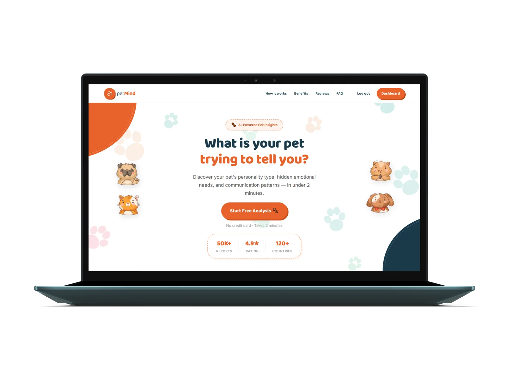

# 🐾 PetMind

A freemium web app that turns a short personality quiz into a personalised care plan for your pet — and helps you track its wellbeing over time.



**Live demo:** _add link after deploy_

## Features

- **Onboarding funnel** — landing → quiz → analysis → sign-up → paywall → checkout → dashboard
- **Species-aware reports** — cat, dog, rabbit, bird (with subspecies), hamster and more, each with tailored personality types and advice
- **Mood journal** — daily log of mood, energy, appetite, sleep and weight
- **Trends & insights** — charts for weight and mood, tips and a weekly summary generated from journal data
- **Pet care** — vaccination dates, multiple pets per account
- **Care coach** — offline, rule-based assistant with species-specific answers
- **Freemium** — free tier plus gated premium features and a checkout flow (payment is simulated)
- **Account management** — sign up / sign in, delete account and all data

## Tech stack

| Area | Tools |
|---|---|
| Frontend | React 18, TypeScript, Vite, React Router v6 |
| Styling | SCSS Modules |
| Charts | Recharts |
| Backend | Supabase — Auth, Postgres, Row Level Security, SQL triggers & functions |

## Architecture notes

- **Row Level Security** on every table — users can only read and write their own rows.
- A **database trigger** creates a profile row whenever a user signs up.
- A **`delete_account()` SQL function** (security definer) removes a user and cascades to all their data.
- **Protected routes** via a `RequireAuth` wrapper and a global `AuthContext` that tracks the session and profile.
- Business logic (personality scoring, insights, coach) lives in `src/lib`, separate from UI components.

## Getting started

```bash
npm install
cp .env.example .env      # then fill in your Supabase URL and public key
npm run dev
```

### Database setup

1. Create a project at [supabase.com](https://supabase.com).
2. In the SQL Editor, run [`supabase/schema.sql`](supabase/schema.sql). It creates all tables, policies and functions in one go.
3. For development, you may turn off **Authentication → Sign In / Providers → Confirm email**.

The numbered `migration_*.sql` files are only needed to upgrade a database created from an older version of the schema.

## Project structure

```
src/
├─ components/
│  ├─ pages/        # Landing, Quiz, Analysis, Auth, Paywall, Checkout, Dashboard…
│  ├─ sections/     # Landing page sections
│  └─ …             # Shared UI: Button, Icon, DatePicker, ConfirmModal…
├─ lib/             # Supabase client, auth, db access, quiz & insight logic
└─ types/
supabase/           # SQL schema and migrations
```

## Limitations

- Payment is a demo form — no real charges and no card data is sent anywhere.
- The coach is keyword-based, not an LLM.
